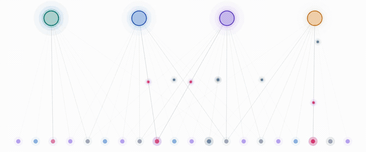

# Resin — Reactive Signal Inference

[](https://arxiv.org/abs/2602.05625)
[](https://github.com/simon-kohaut/resin/actions/workflows/ci.yml)
[](https://github.com/simon-kohaut/resin/actions/workflows/pypi_release.yml)
[](https://pypi.org/project/pyresin/)
[](https://pypi.org/project/pyresin/)
[](LICENSE.md)

<p align="center">
  <b>Resin</b> reasoning ·
  <a href="https://github.com/HRI-EU/ProMis">ProMis</a> mission design ·
  <a href="https://github.com/simon-kohaut/CoFi">CoFi</a> tracking ·
  <a href="https://github.com/simon-kohaut/CoCo">CoCo</a> control
</p>

<p align="center">
  <picture>
    <source media="(prefers-color-scheme: dark)" srcset="docs/reactive_circuits_dark.gif">
    
  </picture>
</p>

<p align="center">
  <b>Reactive Knowledge Representation and Asynchronous Reasoning</b><br>
  Simon Kohaut, Benedict Flade, Julian Eggert, Kristian Kersting, Devendra Singh Dhami<br>
  <a href="https://arxiv.org/abs/2602.05625">Paper</a> · <a href="https://simon-kohaut.github.io/Resin/">Project Page</a> · <a href="#citation">Citation</a>
</p>

**Resin** is a probabilistic first-order logic programming language for building reactive inference pipelines over continuous, asynchronous data streams. 
Resin programs are compiled via Answer Set Programming (ASP) into **Reactive Circuits**: vectorised, self-adapting computation graphs that perform Algebraic Model Counting (AMC) in real time.

### Highlights

- **Resin** merges probabilistic first-order logic with reactive programming: programs declare asynchronous data streams as sources and query targets over them.
- **Reactive Circuits** are time-dynamic DAGs over Algebraic Circuits that adapt their own structure to the estimated *Frequency of Change* of each input, as in the animation above.
- **Exact and incremental:** inference is partitioned into individually memoized sub-problems, so a new input only re-evaluates the parts of the model it affects.

The core library is written in Rust. A Python package (`pyresin`) is published to [PyPI](https://pypi.org/p/pyresin) and built with [Maturin](https://github.com/PyO3/maturin).

## Installation

For employing Resin with Python, you can install the pre-compiled package via PyPI:

```bash
pip install pyresin
```

To use Resin with Rust, you may clone this repository and build locally with `cargo` (see [Development](https://github.com/simon-kohaut/resin/blob/main/docs/development.md)).

## Quick Start

```python
import time
from resin import Resin

# Sources are asynchronous signals; rules and targets are probabilistic logic
resin = Resin.compile("""
rain <- source("/weather/rain", Probability).
sprinkler <- source("/garden/sprinkler", Boolean).
wet if rain.
wet if sprinkler.
wet -> target("/garden/wet").
""")

resin.make_writer("/weather/rain").write([0.3])
resin.make_writer("/garden/sprinkler").write(False)
time.sleep(0.05)  # writers deliver values asynchronously

circuit = resin.get_reactive_circuit()
print(circuit.update())  # {'/garden/wet': array([0.3])}
```

Writing a new value only recomputes the parts of the circuit that depend on it, and `circuit.adapt(...)` restructures the circuit by how often each source changes.

## Built on Resin

<table>
  <tr>
    <td align="center" width="33%"><a href="https://github.com/HRI-EU/ProMis"></a></td>
    <td align="center" width="33%"><a href="https://github.com/simon-kohaut/CoFi"></a></td>
    <td align="center" width="33%"><a href="https://github.com/simon-kohaut/CoCo"></a></td>
  </tr>
  <tr>
    <td align="center"><a href="https://github.com/HRI-EU/ProMis"><b>ProMis</b></a><br>Probabilistic mission design: where an agent's rules are satisfied, kept up to date as the world changes.</td>
    <td align="center"><a href="https://github.com/simon-kohaut/CoFi"><b>CoFi</b></a><br>The Constitutional Filter: tracking agents by trusting them to follow their rules.</td>
    <td align="center"><a href="https://github.com/simon-kohaut/CoCo"><b>CoCo</b></a><br>The Constitutional Controller: steering agents to comply despite their own control inaccuracies.</td>
  </tr>
</table>

## Documentation

- [The Resin Language](https://github.com/simon-kohaut/resin/blob/main/docs/language.md): sources, rules, targets and their semantics.
- [Semirings](https://github.com/simon-kohaut/resin/blob/main/docs/semirings.md): probabilities, most probable explanations, fuzzy logic, satisfiability, gradients, and critical explanations.
- [Learning](https://github.com/simon-kohaut/resin/blob/main/docs/learning.md): fitting clause probabilities and training networks through Resin.
- [Python API](https://github.com/simon-kohaut/resin/blob/main/docs/python.md): compiling programs, writing signals, updating targets and adapting Reactive Circuits.
- [Development](https://github.com/simon-kohaut/resin/blob/main/docs/development.md): building from source, running checks and the pre-commit hook.

## License

See [LICENSE.md](LICENSE.md).

## Citation

If you find our work useful, please consider citing the paper [Reactive Knowledge Representation and Asynchronous Reasoning](https://arxiv.org/abs/2602.05625) (also available via *Cite this repository* on GitHub):

```bibtex
@article{kohaut2026reactive,
  title={Reactive Knowledge Representation and Asynchronous Reasoning},
  author={Kohaut, Simon and Flade, Benedict and Eggert, Julian and Kersting, Kristian and Dhami, Devendra Singh},
  journal={arXiv preprint arXiv:2602.05625},
  year={2026},
  doi={10.48550/arXiv.2602.05625},
  url={https://arxiv.org/abs/2602.05625}
}
```
