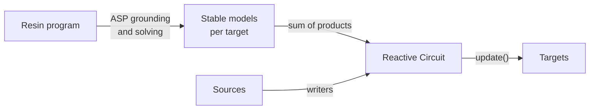

# The Resin Language

A Resin program declares **sources** (incoming signals), **rules** (first-order logic), and **targets** (the quantities to infer).
Resin compiles the program via Answer Set Programming (ASP) into a [Reactive Circuit](python.md#reactive-circuit-adaptation), which recomputes the targets whenever sources change.



## Source types

| Type | Written as | ASP encoding |
|---|---|---|
| `Probability` | a value in `[0, 1]` | choice atom `{name}.` |
| `Boolean` | `true`/`false` | choice atom `{name}.` |
| `Density` | a continuous distribution | exactly-one choice over the intervals induced by the source's thresholds |
| `Number` | a scalar value | exactly-one choice over the intervals induced by the source's thresholds |
| `Categorical` | a vector of class probabilities | `1 { c₀ ; c₁ ; … } 1.` exactly-one constraint |

How to write values to each source type from Python is described in [Writing signals](python.md#writing-signals).

## Syntax

Here is an example Resin program for an autonomous aircraft system navigating an urban environment.

```prolog
# Source declarations
over(park)         <- source("/map/over/park", Probability).
distance(hospital) <- source("/map/distance/hospital", Density).
distance(airport)  <- source("/map/distance/airport", Density).
speed              <- source("/sensor/speed", Number).
flight_hours(w1)   <- source("/metrics/flight_hours/wing_1", Number).
flight_hours(w2)   <- source("/metrics/flight_hours/wing_2", Number).
flight_hours(w3)   <- source("/metrics/flight_hours/wing_3", Number).
flight_hours(w4)   <- source("/metrics/flight_hours/wing_4", Number).
{sunny, raining}   <- source("/weather", Categorical).

# Propositional rules
permitted if over(park) and speed < 25.

# First-order rules
critical_infrastructure(hospital).
critical_infrastructure(airport).
safety_distance(T) if critical_infrastructure(T) and distance(T) > 100.

# Conditional probabilities and Noisy-OR over first-order instantiations
wing(w1). wing(w2). wing(w3). wing(w4).
needs_checkup(W) <- P(0.9) if flight_hours(W) > 100 and wing(W).
any_wing_needs_checkup if needs_checkup(W).

# Target that the program will be constrained on
safe if permitted and safety_distance(T) and not any_wing_needs_checkup and not raining.
safe -> target("/output/safe").
```

## Semantics

- **Rules** support variables (uppercase arguments, in the example above `W` and `T`) and conjunctions (`and`); disjunctions are expressed through multiple clauses with the same head.
- **Probabilistic clauses** (`head <- P(p) if body.`) each get an independent coin, so several clauses for the same head combine as a Noisy-OR.
- **Comparison literals** (`<`, `>`) on `Number` and `Density` sources (ground atom left, constant value right) are derived from the exactly-one interval choice of their source: all thresholds registered for a source partition it into mutually exclusive intervals, so two comparisons on the same source (e.g. `s < 20` and `s < 30`) are never treated as independent.
- **Categorical sources** provide probabilities for mutually exclusive ground atoms that are assumed to sum up to 1.
- **Targets:** a program may declare several targets, each with its own channel. Every target is solved separately into a DNF over the shared source leaves, and all targets live in one reactive circuit, where [adaptation](python.md#reactive-circuit-adaptation) lets them share sub-circuits.

What a target evaluates to depends on the chosen [semiring](semirings.md): by default, the probability that it holds.
