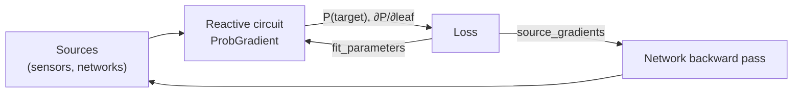

# Learning

Resin programs can learn their own parameters from data.
Under the `ProbGradient` [semiring](semirings.md), every update returns the probability of each target together with its partial derivatives with respect to every leaf of the circuit, so the conditional probabilities `P(p)` of clauses can be fit by gradient descent, and the probabilities of sources can be trained jointly with the networks that produce them.



## Gradients

For a circuit with `n` leaves, `ProbGradient` computes the weighted model count together with its gradient by forward-mode automatic differentiation:

```
[WMC, ∂WMC/∂x₀, ∂WMC/∂x₁, …, ∂WMC/∂xₙ₋₁]
```

> [!NOTE]
> Batched operations are not supported: `value_size` must be `1`, and the circuit's values grow to `1 + n` automatically.

`reactive_circuit.gradient_update()` returns, for every target that was recomputed, its `"probability"` and a dictionary of `"gradients"` from leaf name to partial derivative.
Like `update()`, it only covers targets whose inputs changed, so it returns an empty dictionary once no parameter moved; `full_gradient_update()` recomputes all targets.
Leaf probabilities themselves, rather than clause parameters, can be trained with `reactive_circuit.fit(gradients, lr, loss, atoms, timestamp)`.

## Fitting clause probabilities

The program below states that each wing of a quadcopter with more than 100 flight hours needs a checkup with probability `0.9`.
Given an observed probability of `0.5` for the target, Resin fits the clause probability by minimising the squared error:

```python
import time
from resin import Resin

# An example program for the safe deployment of a quadcopter
code = """
flight_hours(w1)   <- source("/metrics/flight_hours/wing_1", Number).
flight_hours(w2)   <- source("/metrics/flight_hours/wing_2", Number).
flight_hours(w3)   <- source("/metrics/flight_hours/wing_3", Number).
flight_hours(w4)   <- source("/metrics/flight_hours/wing_4", Number).

wing(w1). wing(w2). wing(w3). wing(w4).
needs_checkup(W) <- P(0.9) if flight_hours(W) > 100 and wing(W).
any_wing_needs_checkup if needs_checkup(W).

safe if any_wing_needs_checkup.
safe -> target("/output/safety").
"""

# Make sure to use the ProbGradient semiring for computing gradients alongside probabilities
resin = Resin.compile(code, semiring="ProbGradient")
reactive_circuit = resin.get_reactive_circuit()

# Set all wings' flight_hours above 100 so the condition is active
for channel in [
    "/metrics/flight_hours/wing_1",
    "/metrics/flight_hours/wing_2",
    "/metrics/flight_hours/wing_3",
    "/metrics/flight_hours/wing_4",
]:
    writer = resin.make_writer(channel)
    writer.write([200.0], timestamp=None)
time.sleep(0.05)

# Training parameters
ground_truth = 0.5
learning_rate = 0.1
for timestep in range(500):
    result = reactive_circuit.gradient_update()

    # Updated weights were not enough to invalidate any circuit
    # -> Training converged
    if not result:
        break

    # Get inference and gradient results
    # Gradients are a dictionary from leaf_name -> gradient
    probability = result["/output/safety"]["probability"]
    gradients = result["/output/safety"]["gradients"]

    # Finish once the Mean Squared Error (MSE) is small enough
    if abs(probability - ground_truth) < 1e-3:
        break

    # Compute the MSE gradient and perform a gradient descent step
    # We set parameters to "needs_checkup#0" to only fit the conditional
    # probability of the first clause with that head
    mse = 2.0 * (probability - ground_truth)
    resin.fit_parameters(
        gradients, learning_rate, mse,
        parameters=["needs_checkup#0"], timestamp=float(timestep),
    )

print(f"P(safe) = {probability:.3f} after {timestep} steps")  # P(safe) = 0.499 after 31 steps
```

`fit_parameters(gradients, lr, loss, parameters, timestamp)` applies one gradient descent step, where `loss` is the derivative of the loss with respect to the target probability.
The learnable parameters are listed by `resin.get_parameter_groups()`: each key `"{head}#{clause_index}"` maps to the leaves of all groundings of that clause, which share a single update and so stay in sync.
Sources and comparisons are never modified, and `parameters=None` updates all clause parameters.
Only the parts of the circuit that depend on the updated parameters are recomputed in the next update.

## Training networks through Resin

When leaf probabilities come from a neural network, the `gradients` dictionary provides the upstream values for the network's own backward pass.
All gradients related to a source are collected by `resin.source_gradients(gradients, channel_name)` or, by atom name, `resin.source_gradients_for(gradients, atom_name)`.

> [!NOTE]
> Depending on the network's output layer, gradients may need to be combined.
> For a single output neuron that provides a probability, `full_gradient = gradient[atom] - gradient[-atom]` includes the gradient on the negation.
